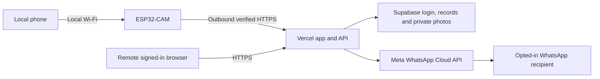

# Optional worldwide access and WhatsApp setup

This folder is the existing Vercel/Supabase remote service. The user deployed it at `https://vision.robetix.com` and applied the original schema and recipient migration. Read-only audit confirmed health, private API denial and existing tables; no real Meta notification or device end-to-end test was performed here. Local CCTV works with both cloud switches Off. New-install account instructions below apply only to genuinely new installations; **do not recreate the existing project or rerun the base schema for authentication changes**.

For Forgot Password, remembered HttpOnly sessions and exact Supabase redirect settings, see [AUTHENTICATION.md](AUTHENTICATION.md). For branch/check/preview/promotion workflow, see [../docs/DEVELOPMENT_WORKFLOW.md](../docs/DEVELOPMENT_WORKFLOW.md). Authentication requires no SQL migration and no changes to existing privileged environment values. A code Preview is not an automatic production merge.

**Dynamic WhatsApp recipients:** see [RECIPIENTS.md](RECIPIENTS.md) for the new authenticated English/Urdu dashboard, encrypted contacts, per-recipient delivery records, repeatable database migration, server setup and validation. Apply `migrations/002_recipients.sql` after the original schema; existing installations run only that migration. It replaces the single camera-stored phone as the authority for recipients.

Supabase is a managed database, account-login and private-file service. It is not an extra computer at the camera. Vercel runs the public application/API. ESP32 makes outbound verified HTTPS requests; there is no port forwarding and no hosted page attempts to fetch a private LAN IP.

## Accounts and deployment

1. Create a dedicated Supabase project. In its SQL editor, review and run `schema.sql` once, then `migrations/002_recipients.sql`. They create `rv_*` tables, service-role-only RPCs and a private `rv-media` bucket capped at 128 KiB per JPEG. Do not add public storage policies. They deliberately disable public access on that named bucket and recipient/delivery tables.
2. Under Supabase Authentication, disable public sign-ups and create your own account. Set a strong unique password (at least 12 characters), appropriate password policy and short access-token lifetime. The current remote UI supports password login; MFA enrollment/challenge and password recovery UI are **not implemented**. Use a private deployment while evaluating and complete an independent security review before wider use.
3. Push this repository to a private GitHub repository of your choice. `.env*`, `.vercel`, node_modules and build files are ignored; `.env.example` contains names/placeholders only. Never commit actual project keys, access tokens or device credentials.
4. Create a **new** Vercel project from that repository. Set Root Directory to `remote`, framework Other, static output `public`, no build command. Node 22+ is required. API functions reside under `remote/api`; they use native fetch and have no npm library dependencies. `node --test test/*.test.mjs` runs the software integration checks.
5. Set **NODEJS_HELPERS=0** in Vercel for all environments so the handlers receive raw JPEG/webhook request streams; query parameters are parsed from the URL when helpers are disabled. Add the variables listed in `.env.example` as server environment secrets in Vercel. `SUPABASE_URL`, `SUPABASE_ANON_KEY`, and `SUPABASE_SERVICE_ROLE_KEY` come from your dedicated project. The service role key bypasses RLS and belongs only on the backend. It is never returned by an endpoint or embedded in either browser app or firmware.
6. Set a random `CRON_SECRET` (at least 32 random bytes). `vercel.json` schedules bounded daily maintenance at 03:00 UTC. Confirm your selected Vercel plan supports the schedule and functions. No plan is assumed to provide unlimited free operation.
7. Deploy and test login on Vercel's generated HTTPS address first. Then add **vision.robetix.com** in that project's Domains panel. Copy **the exact DNS record(s) Vercel supplies** to your DNS provider. Do not change the apex/main website, portfolio or other subdomains. Wait for Vercel to verify DNS and issue its certificate. No DNS or existing website was changed during implementation.

## Pair the ESP32

New firmware: follow [the consumer setup and live activation guide](../docs/REMOTE_LIVE.md). Use Settings → Connect to my account with the code from Add Camera. The service URL and public TLS roots are built in. Migration 003 must be installed and setup enabled; existing deployments remain gated until then. The instructions below describe the retained advanced/legacy configuration.

1. Connect the camera to Internet-enabled STA Wi-Fi and synchronize its clock (opening the authenticated local app supplies browser time; NTP is optional). PSRAM is required for this release's optional photo staging.
2. Sign in to the hosted remote app and choose **Pair a camera**. It generates a random 10-character code expiring in five minutes. Only its hash is stored. New codes invalidate the same account's previous unused code.
3. Sign in to the camera's **local** administrator page. In Advanced → Worldwide Access, enter the service HTTPS hostname and code. A service administrator must supply the site's **trusted root CA PEM** in the installer field. Export/obtain the public root certificate from a trusted source for the service's actual chain; do not use an arbitrary certificate received over unauthenticated HTTP. The browser chain and certificate issuer may vary. Renew this configuration if the trusted root changes.
4. Choose Pair. The backend atomically consumes the code, binds the device to the signed-in account, and issues a random device credential. The firmware stores that credential in NVS and never returns it through the settings/status API. The Meta token is never present on the ESP32. NVS is not encrypted against physical flash extraction in this build.
5. After pairing, enable Access Camera from Anywhere. The service receives a heartbeat approximately once per minute and motion snapshots/events. Activity photos are saved snapshots. The separately activated WSS live viewer is described in [REMOTE_LIVE.md](../docs/REMOTE_LIVE.md). At most 12 recent events/photos are kept per device, with configurable age retention of 1–30 days (default 7). This is cloud retention, separate from the SD policy.
6. Test from mobile data or another network. Check last seen, online/offline, activity and authenticated photo access. Try an unrelated account and an unauthenticated request; neither may obtain the image. Disconnect device in the remote app revokes the device credential immediately on the server. Re-pair locally with a fresh code to reconnect.

Turning local Worldwide Access Off stops future event/photo uploads for remote use and sends a disable update when connectivity permits. Existing server state cannot be updated instantly through a broken Internet connection; revoke in the remote app to disable server access. An in-flight request or previously downloaded photo cannot be recalled. With WhatsApp still enabled, its explicitly allowed event/photo uploads continue. To stop all cloud work, turn off both switches. Privacy suppresses queued photo/event submission; a request already in flight may finish.

## WhatsApp Business prerequisites

Create a Meta developer app with WhatsApp Business Platform/Cloud API, a Business account and sender phone-number ID. Complete account/sender verification, permissions, production token management, and billing as required by Meta. Obtain recipient opt-in for these camera alerts. This is not the ordinary WhatsApp consumer application's automation API.

Configure these server secrets:

- `META_ACCESS_TOKEN`: appropriate business/system-user credential with WhatsApp permissions. Rotate it and protect the Vercel account.
- `META_PHONE_ID`: sender's phone-number ID, not the recipient number.
- `META_GRAPH_VERSION`: a currently supported Graph API version from your Meta application documentation, for example its `vNN.N` identifier. The code deliberately does not assert an unverified current version.
- `META_TEMPLATE_IMAGE`, `META_TEMPLATE_TEXT`, `META_TEMPLATE_LANGUAGE`: exact approved template names and language code.
- `META_APP_SECRET`: for verifying POST webhook HMAC signatures.
- `META_WEBHOOK_VERIFY_TOKEN`: a new random verification secret you also enter when configuring the webhook.

Approve two templates matching the implementation: an image-header alert and a text-only alert. Both have exactly two body parameters, camera name and timestamp. Example body: `Robetix Vision Alert. Camera: {{1}}. Movement detected. Time: {{2}}.` The image version must have an IMAGE header. Add a sample image when requesting template approval as required by Meta; actual alerts upload the captured JPEG using `/PHONE_ID/media` and refer to its media ID in `/PHONE_ID/messages`. These images are not published as unauthenticated URLs. Meta determines the allowed category, approval and pricing. Review the current account documentation before approval; access to several Meta documentation pages returned rate-limit errors during implementation.

Configure the Meta callback URL as `https://YOUR_SERVICE/api/webhook`, the verify token above, and subscribe to message status updates. The handler verifies POST signatures using the app secret. Submitted, delivered, read, failed, rate_limited and unknown are separate states; out-of-order sent receipts cannot downgrade delivered/read.

On the camera, Advanced → WhatsApp Alerts: use **Manage WhatsApp recipients** to open the configured hosted service, sign in, and add up to five consenting contacts with their own preferences. No Meta credential change or firmware upload is needed when contacts change. Set `RECIPIENT_ENCRYPTION_KEY` once on the backend as described in RECIPIENTS.md. The camera still controls the upload switch, alert timezone, photo inclusion and camera-wide interval. Camera Test Notification captures a real current frame and fans out to eligible contacts. A hosted per-contact test sends only to that contact and uses a recent stored photo if requested. Backend submission requires an actual Meta message ID; delivery requires the signed receipt. **No end-to-end success has yet been demonstrated with your account.** Disabling WhatsApp does not disable local event history or the browser alarm.

## Bounds and failure behavior

- One camera-side cloud queue slot; one 128 KiB PSRAM photo. Frames larger than this or a busy slot are dropped with diagnostics. Cloud retries the same event ID at most three times with bounded backoff. It skips requests when internal heap/largest-block margins are low. Local capture/AVI never waits for HTTP requests.
- The HTTPS peer/hostname is verified against the configured root; redirects are rejected. A valid clock is required. Each response is bounded to 4 KiB; connect/read/TLS timeouts are bounded. Cloud tasks may still affect shared Wi-Fi bandwidth and require physical stress testing while recording.
- Device tokens are hashed in the database, scoped to one camera and revocable. Pair codes are single-use/short-lived; database RPCs serialize claim, notification cooldown and sending leases. RLS denies direct anonymous/authenticated table access. Account photo requests verify ownership and the remote switch.
- The backend rate-limits login/pairing, heartbeats, event uploads (10/minute, 1000/day per device), and tests (1/minute). Camera-wide and per-recipient cooldowns are serialized. The default message-attempt budget is 100 per camera per 24-hour rate window, configurable through `WHATSAPP_DAILY_LIMIT`. Unique device/event and event/recipient keys plus sending leases prevent repeated submissions.
- A sending lease prevents two workers from submitting the same alert. If a message request times out after it might have been accepted, outcome is **unknown** and is not retried automatically. This trades a possible missed notification for duplicate avoidance. A killed function can leave `sending` until maintenance marks it unknown. Queued work has a small daily maintenance fallback; this is not a high-availability notification queue.
- Retention runs on event access/ingestion plus daily maintenance. Cleanup errors can delay physical deletion; private photo routes still enforce the configured age. Check storage usage and maintenance logs. The bounded maintenance example targets a small installation and needs pagination/operational monitoring before a larger service.
- Vercel function durations/payloads and Supabase storage/egress/DB quotas apply. Provision budget alerts. Meta messaging/template/media processing may incur charges. No promise of free unlimited service is made.
- Remote camera-control commands, device OTA, MFA UI, formal penetration testing, encrypted device flash, and production availability guarantees are deferred. Hosting on Vercel alone does not provide NAT traversal to a LAN camera. The implemented low-FPS relay still needs public deployment and measured hardware bandwidth, cost and reliability tests. At 30 KiB/image × 1 FPS, payload alone is about 2.6 GB/day per continuous viewer; this is an example calculation, not a hardware measurement.

Primary references: [Vercel native request helpers](https://vercel.com/docs/functions/runtimes/node-js/advanced-node-configuration), [Vercel limits](https://vercel.com/docs/functions/limitations), [Supabase RLS](https://supabase.com/docs/guides/database/postgres/row-level-security), [private storage access](https://supabase.com/docs/guides/storage/security/access-control), [WhatsApp policy](https://whatsappbusiness.com/policy/), [Meta template documentation](https://developers.facebook.com/documentation/business-messaging/whatsapp/messages/template-messages), [Meta media documentation](https://developers.facebook.com/documentation/business-messaging/whatsapp/business-phone-numbers/media).
